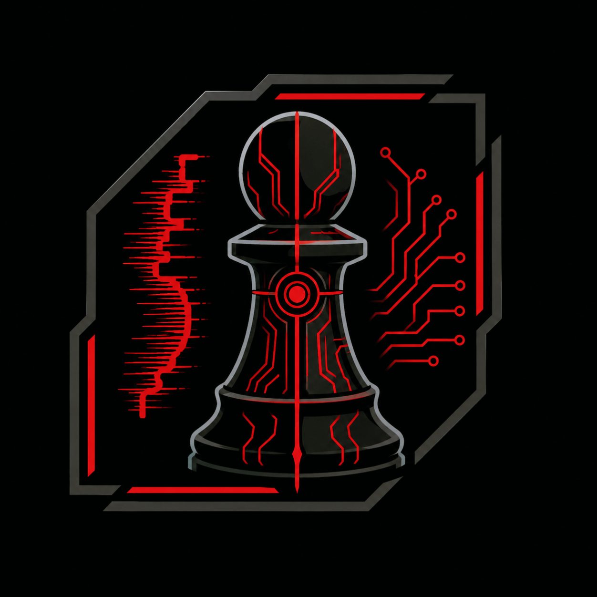

# MissingPawn - Open-Source Chess Engine

> A modern UCI chess engine focused on pawn structure, positional restriction and experimental evaluation.

## About


MissingPawn is an open-source chess engine implementing the **Universal Chess Interface (UCI)** protocol. It is designed to provide strong play while serving as a platform for experimenting with modern search algorithms and evaluation techniques.

The project is under active development and new features are added regularly.

## Installation

Download the latest release and add `MissingPawn.exe` to your favorite UCI-compatible GUI.

Examples include:

- Arena
- Cute Chess
- Banksia GUI
- Fritz
- ChessBase

A chess engine written in C++.
## Requirements
- C++20 compiler (MSVC 2022 or GCC 12+ recommended)
- CMake 3.20+
- Windows: Windows SDK. No third-party libraries are required.

The project also uses GitHub Actions for Windows builds and regression tests on pushes and pull requests.

## Build
From the repository root:

```powershell
cmake -S . -B build -A x64 -DBUILD_TESTING=ON
cmake --build build --config Release --parallel
ctest --test-dir build -C Release --output-on-failure
```

For other CMake generators, omit `-A x64` and the `-C Release` arguments as appropriate.

## Usage

Run the engine from any UCI-compatible chess GUI.

Or from the command line:

```bash
MissingPawn.exe
```

The engine automatically switches to UCI mode after receiving the `uci` command.

## Strength

MissingPawn includes built-in opening book knowledge and iterative-deepening search with time management.
The Elo rating is stored in Releases.

Documentation

- [Changelog](Changelog.md) — A version-by-version summary of changes, improvements, and new features.
- [Experimental Features](Experimental.md) — An overview of selected experimental systems and concepts developed for MissingPawn.
- [Third-Party Notices](THIRD_PATRY_NOTICES.md) — Information about third-party components, dependencies, and their applicable licenses or notices.

## License

This project is released under the [GNU General Public License v3 License](LICENSE).

## Author

**Missing Player/Kacper Wieczorek**

# MissingPawn

*"Even a pawn can decide the game."*
